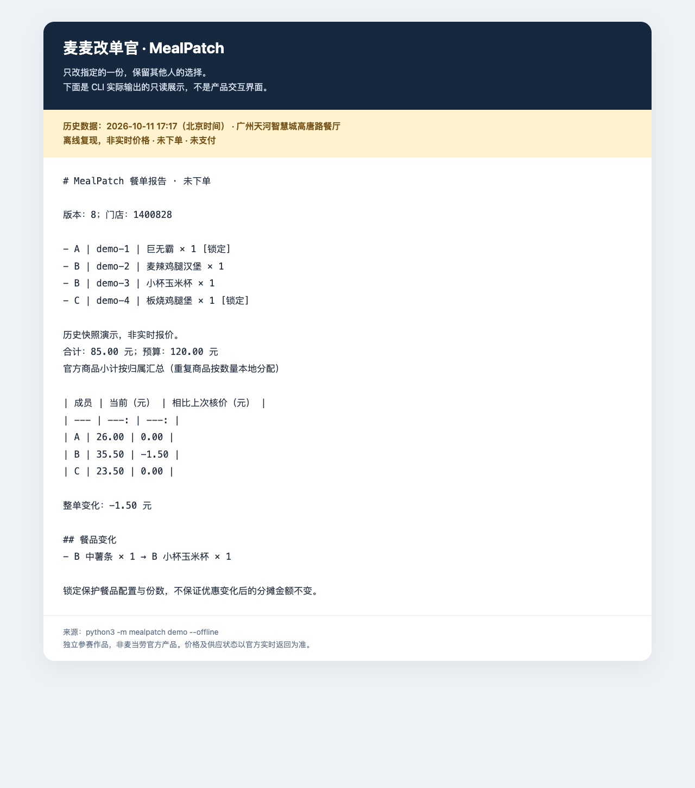

# 演示：只改 B 的一份，保留 A/C 的选择

这是一份可复现的历史核价演示，面向汇总2～6人餐单的组织者。核心价值不是找最低价，而是把“改了什么、总价变多少、谁承担多少”解释清楚。

## 30秒运行

在产品根目录（包含mealpatch的目录）运行：

```sh
python3 -m mealpatch demo --offline
```

无需Token，不写用户草稿，不访问网络。数据来源为2026-10-11 17:17北京时间广州天河智慧城高唐路餐厅的真实核价历史摘要，不是当前实价。

完整流程：三人建草稿 → 锁定A/C → 首次核价 → B中薯条换小杯玉米杯 → 新版本核价 → 展示差异与分账。offline用历史快照替代两次网络返回，不能称为“现场调用”。online模式才会重新查询真实门店、菜单和核价，且需要Token；耗时、价格和供应不保证与本示例一致。

| 成员 | 改前 | 改后 | 金额变化 |
| --- | --- | --- | ---: |
| A（锁定） | 巨无霸 | 不变 | 26.00 → 26.00元 |
| B | 麦辣鸡腿汉堡＋中薯条 | 麦辣鸡腿汉堡＋小杯玉米杯 | 37.00 → 35.50元 |
| C（锁定） | 板烧鸡腿堡 | 不变 | 23.50 → 23.50元 |
| 合计 | | | 86.50 → 85.00元 |

报告为“未下单”，没有订单号或支付动作。本例无优惠；其他场景即使餐品锁定，分摊也可能因整单优惠变化而改变。

## 展示材料

- [实际输出文本](result.md)
- [只读报告展示页](report.html)：本地浏览器打开，不包含脚本或网络请求，不是新实现的网页产品。
- [结果截图](result.png)：上述展示页的浏览器截图，包含历史时间、非实时与未下单标识。
- [约60秒讲解稿](narration.md)



## 录屏建议

| 时间 | 画面 | 要点 |
| --- | --- | --- |
| 0～10秒 | 终端中显示离线演示命令 | 多人临时改餐，容易误动他人的选择；说明历史数据 |
| 10～25秒 | 执行命令，显示三人餐单与锁定标记 | A/C锁定，仅B换小食 |
| 25～45秒 | 报告的逐人费用与整单差额 | B少1.50元，A/C不变，合计85.00元 |
| 45～60秒 | 展示历史标识及未下单提示 | 在线由官方核价，失败不造价；不下单、不支付 |

录制前隐藏个人路径、通知、环境变量和其他应用内容，不展示Token输入。当前交付截图与脚本，不宣称已录制视频。

## 重新生成

```sh
python3 scripts/build_demo.py
```

会从应用生成历史结果文本和HTML，固定示例行ID以便复现，不读取个人配置；截图须在浏览器中重新拍摄。在线验证方式与工具边界见[MCP集成说明](../MCP_INTEGRATION.md)。
